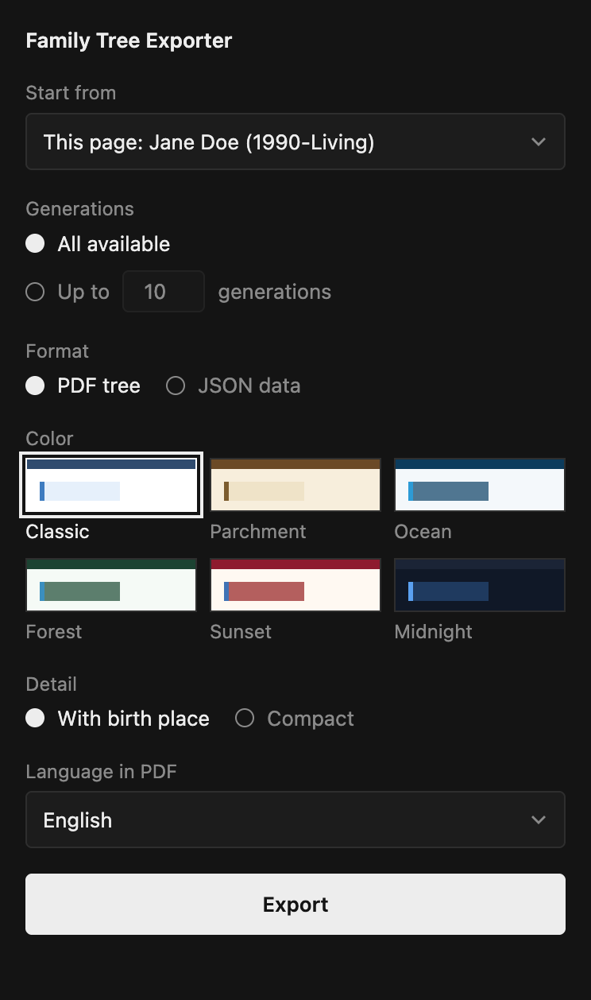
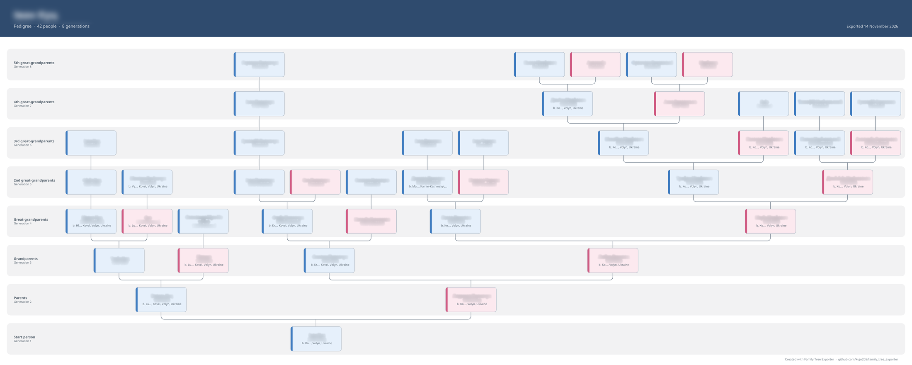
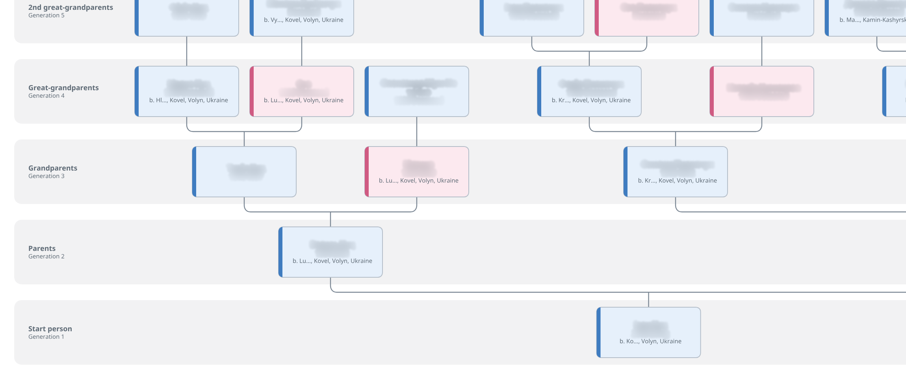

# Family Tree Exporter

A Chrome extension that exports your FamilySearch ancestors as a PDF pedigree chart.

## Install

The ready-to-use extension is the [`dist`](dist) folder, so no build is needed.

1. Clone this repo (or download it as a ZIP and unzip it).
2. Open `chrome://extensions` in Chrome and turn on **Developer mode** (top right).
3. Click **Load unpacked** and select the **`dist`** folder.
4. Pin the extension from the puzzle-piece menu if you want it in the toolbar.

After pulling updates, click the reload icon on the extension card and reload your FamilySearch tab.

## Develop

Requires [Node.js](https://nodejs.org) 18 or newer. Run `npm install`, then `npm run build` to rebuild `dist/` from `src/`. `dist/` is committed, so rebuild and commit it together with source changes.

## Use

1. Sign in at [familysearch.org](https://www.familysearch.org) and open a person in Family Tree.
2. Click the extension icon.
3. Pick the person to start from (the open page or yourself), the number of generations (all or a limit), the format, color, detail and language.
4. Click **Export**. The file downloads when the crawl finishes.

## Example

A pedigree exported with the Classic color scheme. Names and years are blurred and settlements are shortened for privacy. Click an image to see it full size.

## Features

- Portrait pedigree PDF with the start person at the bottom and ancestors above.
- Six color schemes, with or without birth places.
- PDF text in English, Ukrainian, German or Spanish. Names and places stay as stored on FamilySearch.
- Every person in the PDF links to their FamilySearch page.
- JSON export of the collected data.

## Notes

- Requests run in your signed-in browser session, throttled and with retries. Nothing is sent anywhere except to FamilySearch.
- Living people are masked by FamilySearch, so they appear without details.
- Very large trees make very wide pages (capped at 14,400 pt, then scaled down).
- Meant for personal use. Check FamilySearch's terms before bulk downloads.
